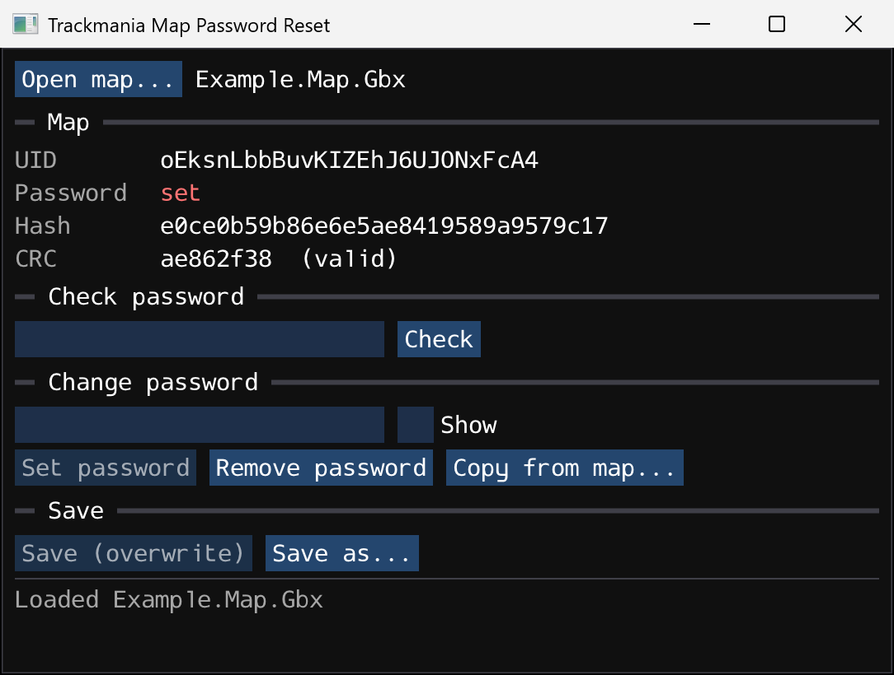
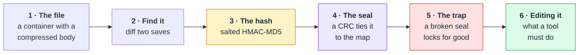
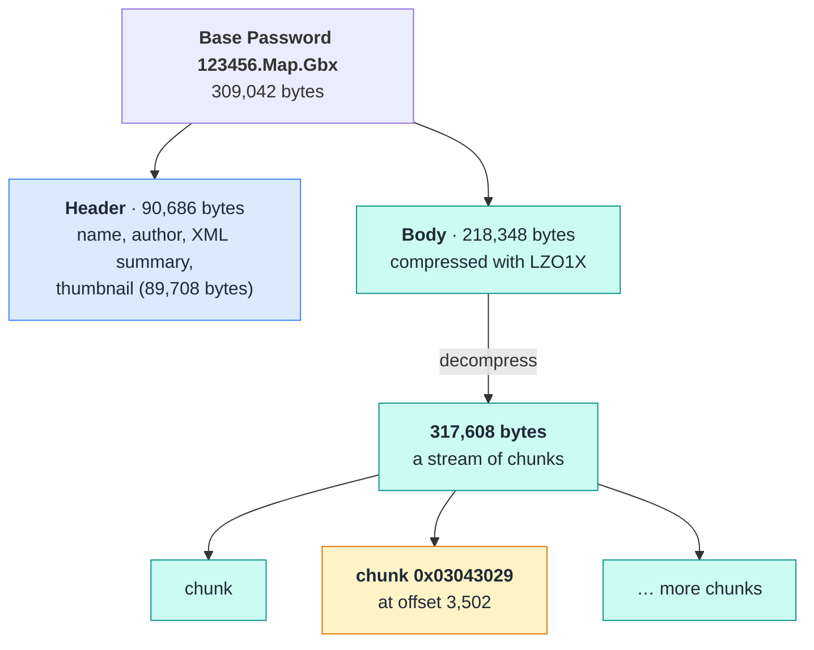
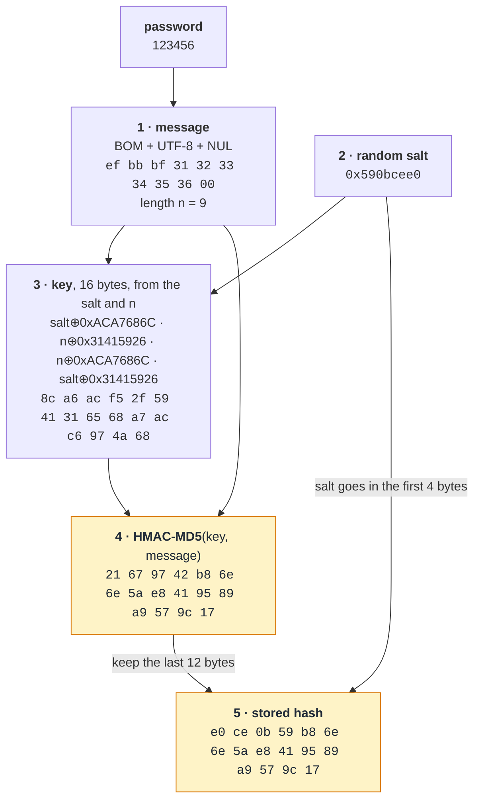
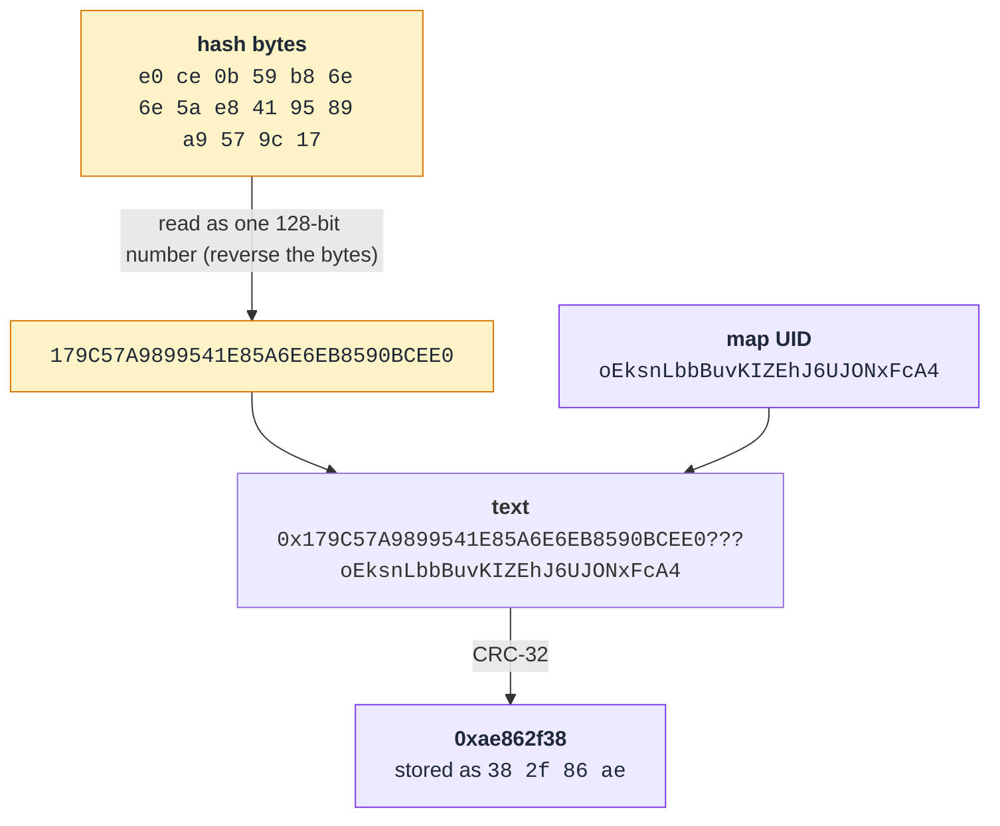
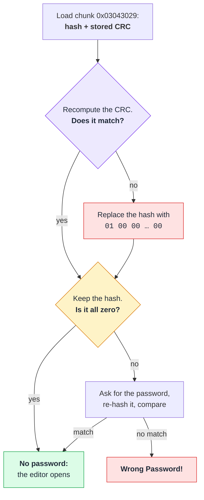
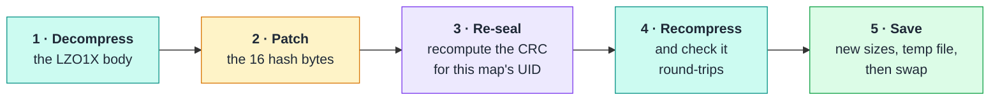

# Trackmania Map Password Reset

[](https://github.com/frisksitron/trackmania-map-password-reset/actions/workflows/build.yml)

Check, change or remove the editor password of a Trackmania (2020) `.Map.Gbx`
file, and learn how map passwords work along the way.

> **This is a proof of concept for educational purposes.** It documents how
> Trackmania map passwords work and demonstrates the format. It is not an
> official tool, and it comes with no warranty. Keep backups of any map you
> open with it. Use it only on your own maps, or on maps whose author has
> given you permission.



**Contents:** [The tool](#the-tool) ·
[How map passwords work](#how-map-passwords-work) ·
[Building](#building) · [Further reading](#further-reading) ·
[Appendices](#appendix-a-reference)

## The tool

A small native app (Dear ImGui) for Windows, macOS and Linux.

- **Inspect.** Shows the map UID, whether a password is set, the stored hash,
  and whether its checksum is valid.
- **Check** whether a password is correct.
- **Set** a new password or **remove** it. You don't need the old one.
- **Copy** the password from another map.
- **Repair** maps whose password was "removed" with a hex editor. Those maps
  are actually locked for good; see [the trap](#5-the-trap).

```
tm-map-password-reset [map.Map.Gbx]
```

You can also open a map with the **Open map…** button or by dragging it onto
the window. Edits stay in memory until you click **Save** or **Save as…**.

**Download** from the
[latest release](https://github.com/frisksitron/trackmania-map-password-reset/releases/latest),
or [build it yourself](#building):

| Platform | File | Notes |
|---|---|---|
| Windows | `tm-map-password-reset.exe` | Run it directly. Windows SmartScreen may warn because it isn't signed: **More info → Run anyway**. |
| macOS | `tm-map-password-reset-macOS.tar.gz` | Extract and open the `.app`. It isn't signed, so macOS blocks the first launch. Allow it in **System Settings → Privacy & Security → Open Anyway**. |
| Linux | `tm-map-password-reset-Linux.tar.gz` | Extract and run `./tm-map-password-reset`. |

The macOS and Linux builds are compiled and tested automatically but haven't
been tried by hand yet.

## How map passwords work

In the Trackmania (2020) map editor you can lock a map with a password. After
that, nobody can open it in the editor without typing the password first.

This section answers two questions: **where does that password go**, and
**what stops someone from simply deleting it?** To answer them, we follow one
small test map, locked with the password `123456`, from the editor all the way
down to individual bytes in the file. Each step introduces one idea. Links
point to good introductions if you want to go deeper.

You don't need a background in file formats or cryptography. You do need to be
comfortable seeing numbers written in [hexadecimal][hex], such as `0x1F` or
`e0 ce 0b 59`, where every two hex digits are one byte.



### 1. The file: a container with a compressed body

A map is saved as a `.Map.Gbx` file. GBX ("GameBox") is the container format
Nadeo's engine uses for almost everything it saves: maps, replays, items,
skins. The community has documented it well; the [GBX page on the Xaseco
wiki][gbx-wiki] and the [GBX.NET][gbx-net] library are the classic references.

A GBX file has two parts:

- **A header** that is quick to read. It holds the map's name, author, a
  thumbnail and an XML summary, so the game can list maps without loading
  them fully.
- **A body** with everything else, [compressed][compression] with
  [LZO][lzo], a fast general-purpose compression algorithm.

Once decompressed, the body is a sequence of **chunks**. Each chunk starts with
a 4-byte ID that says what kind of data follows. Many chunks are marked
"skippable": after the ID comes the text `PIKS` ("SKIP" backwards) and the
chunk's size, so a reader that doesn't understand the chunk can jump over it.

Here is the test map, from the file on disk down to the chunk that holds the
password:



Up close, that chunk is 32 bytes:

| `29 30 04 03` | `50 49 4B 53` | `14 00 00 00` | `e0 ce 0b 59 b8 6e 6e 5a e8 41 95 89 a9 57 9c 17` | `38 2f 86 ae` |
|:---:|:---:|:---:|:---:|:---:|
| chunk ID `0x03043029` | `PIKS`: skippable | size: 20 bytes | **hashed password**, 16 bytes | **CRC**, 4 bytes |

So the password, wherever it is, sits inside compressed data. You can't find
it by searching the file in a hex editor.

### 2. Finding the password: spot the difference

The simplest way to find where a program stores something is to change only
that one thing and compare the results. The test map was saved twice: once
without a password, and once locked with `123456`. After decompressing both
bodies and comparing them, exactly one chunk differs because of the password:
chunk **`0x03043029`**.

| Saved | Hashed password (16 bytes) | CRC (4 bytes) |
|---|---|---|
| without a password | `00 00 00 00 00 00 00 00 00 00 00 00 00 00 00 00` | `5b 9b 24 ee` |
| with `123456` | `e0 ce 0b 59 b8 6e 6e 5a e8 41 95 89 a9 57 9c 17` | `38 2f 86 ae` |

All zero in the hash means "no password". The CRC is a checksum, explained in
section 4.

Two things stand out. Neither field contains `123456` in any readable form, so
the game doesn't store the password itself. And a map without a password still
has a non-zero checksum. The next two sections explain both.

### 3. The hash: why the password isn't stored

Programs that check passwords shouldn't store the password itself. They store
a **[hash][hash]**: a fixed-size fingerprint computed from the password. It is
easy to compute in one direction and impractical to reverse. To check a typed
password, the program hashes it the same way and compares the fingerprints.
The [OWASP password storage cheat sheet][owasp] explains the reasoning.

Trackmania builds its 16 bytes like this:



Every value above is real: this reproduces the hash stored in the test map
(⊕ means [XOR][xor]).

Step by step:

1. **Prepare the text.** The password gets a [byte-order mark][bom] (BOM,
   the character U+FEFF) in front. It is then encoded as [UTF-8][utf8], which
   turns the BOM into `ef bb bf`, and a zero byte is added at the end. The BOM
   is an unusual detail, and it's why a plain MD5 of "123456" doesn't match.
2. **Pick a salt.** A **[salt][salt]** is a random number mixed into the hash
   so that the same password doesn't always produce the same result. Here it
   is 4 random bytes.
3. **Make a key.** The salt and the text's length are combined with two fixed
   constants using [XOR][xor] to form a 16-byte key.
4. **HMAC-MD5.** **[HMAC][hmac]** is a standard way to compute a hash that
   depends on a secret key; here it uses the [MD5][md5] hash function. The
   result is 16 bytes.
5. **Store the salt.** The first 4 bytes of the result are replaced by the
   salt. To check a typed password, the game reads the salt back from those
   4 bytes, repeats steps 1–4 and compares the remaining 12 bytes.

Because the salt is random, locking the same map twice with the same password
gives two different hashes. Both are valid:

| Locked with `123456` | Salt | Last 12 bytes of HMAC-MD5 |
|---|---|---|
| first time | `e0 ce 0b 59` | `b8 6e 6e 5a e8 41 95 89 a9 57 9c 17` |
| second time | `5a 33 99 32` | `8f 1f 1f b6 9a 54 cf 33 d8 60 03 2c` |

A note on strength: MD5 is [no longer considered secure][md5-sec] for many
purposes, and a fast hash like this can be guessed quickly for short
passwords. That doesn't really matter here, because, as we'll see, the
password check only protects the editor UI. It doesn't encrypt anything.

### 4. The seal: a checksum tied to the map

The 4 bytes after the hash are a **[CRC-32][crc]**, a checksum. A checksum
isn't a security feature like the hash. It's a cheap way to detect that data
has changed by accident (or, here, been edited by hand).

What makes this one interesting is *what* it covers. The game builds a short
piece of text from the hash and the map's unique ID (UID), then checksums that
text:



- The 16 hash bytes are read as one 128-bit number. The file stores numbers
  [little-endian][endian], least significant byte first, so printing it means
  reversing the bytes.
- `???` is a fixed separator.
- The result is stored little-endian too, which is why `0xae862f38` appears in
  the file as `38 2f 86 ae`.

Because the UID is part of the input, the checksum seals the hash to *this*
map. Copy the 16 bytes into another map and the checksum no longer matches.
The same applies to a map without a password: the hash is all zero, but the
checksum still depends on the UID, so it's different for every map.

### 5. The trap

Here is the question from the start: **what stops someone from opening the
file, zeroing the 16 hash bytes, and removing the password?**

The checksum does, in a way that makes things worse rather than just failing.
When the game loads a map, it recomputes the checksum. If it doesn't match the
stored one, the game doesn't reject the map. It **quietly replaces the hash
with `01 00 00 … 00`**:



That replacement hash isn't zero, so the editor asks for a password. But it
says "password set" with a salt of 1 and an all-zero fingerprint. No real
password produces it, so every attempt ends at "Wrong Password!". A hand-edited map ends up locked for good,
not unlocked. Maps "unlocked" this way do circulate.

The fix is to recompute the checksum to match the zero hash for that map's
UID. With a matching checksum the game sees "no password" and opens the editor
normally.

### 6. Editing it properly

Putting it all together, changing the password correctly takes five steps:



The tool in this repository does exactly this. Removing a password writes 16
zero bytes. Setting one writes a fresh salted hash. Copying takes another
map's hash. Every one of these needs step 3, recomputing the checksum for
*this* map's UID. Repairing a hand-edited map is just "remove" again, with a
correct checksum this time.

### 7. How we found out

Sections 1, 2 and 4 come from comparing files, plus some educated guessing:
searching over plausible combinations of hash, UID and separators found the
checksum formula. The hash recipe (section 3) and the load-time rule
(section 5) can't be guessed from the files. They needed a look inside the
game itself.

That kind of work is called [static analysis][static]: reading a program's
compiled machine code without running it. The usual workflow:

1. **Start from a string.** The text "Wrong Password!" appears in the
   program. Finding the code that uses it leads to the function that checks
   the password.
2. **Follow the calls.** That function calls the one that hashes the typed
   password. That one leads to the key construction, and from there to the
   HMAC.
3. **Read the data flow.** The code that reads chunk `0x03043029` from a file
   shows the checksum comparison and what happens on a mismatch (section 5).

Tools commonly used for this are [Ghidra][ghidra], a free
reverse-engineering suite from the NSA, and disassembler libraries such as
[Capstone][capstone]. Windows programs use the [PE file format][pe], and
reading x64 code is much easier once you know the [calling
convention][x64cc]. For `Trackmania.exe`, a full Ghidra analysis was too slow,
so this work used a simpler linear disassembly with Capstone. The specific
addresses are in [Appendix B](#appendix-b-where-it-lives-in-the-game).

Everything was then checked against the real files. The hash recipe
reproduces the stored hash exactly, the checksum formula matches maps saved by
the game, and a map repaired by the tool opens in the editor without a
password prompt.

### 8. What this protection is, and isn't

The map password is a lock on the editor's front door, not a safe. The map
data isn't encrypted, so anyone can load and drive the map. The password only
decides whether the editor will open it. The hash keeps the password from
being read directly out of the file. The checksum keeps casual hex edits from
working, and punishes them.

That is a reasonable design for its purpose: keeping people from
accidentally, or casually, editing someone else's map. It isn't meant to stop
a determined person with the file, and this explanation shows why it can't be.
Treat map passwords as a request from the author, and respect them.

## Building

Requires CMake 3.20+ and a C++17 compiler. Dear ImGui, GLFW and
portable-file-dialogs are downloaded automatically at pinned versions.

```
cmake -B build -DCMAKE_BUILD_TYPE=Release
cmake --build build --config Release
ctest --test-dir build -C Release
```

On Windows the result is a single self-contained `tm-map-password-reset.exe`.

Linux also needs the GLFW/OpenGL development packages, for example on
Debian/Ubuntu:

```
sudo apt install build-essential cmake pkg-config libgl-dev libx11-dev libxrandr-dev \
     libxinerama-dev libxcursor-dev libxi-dev libwayland-dev libxkbcommon-dev
```

The file dialogs on Linux use `zenity` or `kdialog`. Drag and drop works
without them.

To build only the core library tests and skip the GUI dependencies, add
`-DTM_BUILD_GUI=OFF`.

| Path | |
|---|---|
| `src/map_password.h` | Everything about the format: GBX parsing, LZO1X, hash, CRC. No dependencies. |
| `src/main.cpp` | The GUI |
| `tests/test_core.cpp` | Checks against values written by the game |

## Further reading

| Topic | Link |
|---|---|
| Hexadecimal and hex dumps | [Wikipedia: Hexadecimal][hex], [Hex dump][hexdump] |
| Byte order | [Wikipedia: Endianness][endian] |
| GBX file format | [Xaseco wiki: GBX][gbx-wiki], [GBX.NET][gbx-net] |
| Compression | [Wikipedia: Lossless compression][compression], [LZO][lzo] |
| Text encoding | [Wikipedia: UTF-8][utf8], [Unicode FAQ: BOM][bom] |
| Hashes and salts | [Wikipedia: Cryptographic hash function][hash], [Salt][salt], [OWASP: Password Storage][owasp] |
| HMAC and MD5 | [RFC 2104 (HMAC)][hmac], [RFC 1321 (MD5)][md5], [RFC 6151 (MD5 security)][md5-sec] |
| Checksums | [Wikipedia: Cyclic redundancy check][crc] |
| Reverse engineering | [Wikipedia: Static program analysis][static], [Ghidra][ghidra], [Capstone][capstone], [PE format][pe], [x64 calling convention][x64cc] |

---

## Appendix A: Reference

Notation: `le32(x)` is `x` as 4 little-endian bytes, `+` is concatenation,
`x[i:j]` is bytes `i` to `j-1`.

**Chunk `0x03043029`**, skippable, 20 bytes:

```
29 30 04 03   "PIKS"   14 00 00 00
byte[16] hashed_password          all zero = no password
uint32   crc
```

**Hash:**

```
s    = utf8(U+FEFF + password)
n    = len(s)                                   byte length, BOM included
salt = random uint32
key  = le32(salt ^ 0xACA7686C) + le32(n ^ 0x31415926)
     + le32(n ^ 0xACA7686C)    + le32(salt ^ 0x31415926)
hash = le32(salt) + HMAC_MD5(key, s + "\0")[4:16]
empty password -> 16 zero bytes
```

**Checksum** (standard CRC-32, as in zlib/PNG):

```
crc = crc32("0x" + hex_upper(reverse(hash)) + "???" + map_uid)
```

**Load rule:** if `crc` doesn't match, the effective hash becomes `01` followed
by 15 zero bytes.

**File layout:** `"GBX"`, version 6, format `"BUCR"`, class ID `0x03043000`
(`CGameCtnChallenge`), header chunks, node count, external-reference count,
then the body's uncompressed size, compressed size and LZO1X data. The map UID
is read from body chunk `0x0304301F`, which starts with the map's ident.

## Appendix B: Where it lives in the game

Addresses are virtual addresses in this build (image base `0x140000000`).
They will move when the game updates.

| | |
|---|---|
| `Trackmania.exe` file version | 2026.2.2.1751 (maps report `exebuild="2026-02-02_17_51"`) |
| `Trackmania.exe` SHA-256 | `3fc7d8cda542beda131c44306b123f4004d07d7e22f512b46b762afc29f6edda` |

| Address | Role |
|---|---|
| `0x140b8529f` | chunk `0x03043029` read/write: hash at `CGameCtnChallenge + 0xC0` |
| `0x14012c350` / `0x14012c310` | read or write the 16-byte hash / the 32-bit CRC |
| `0x140110830` | format the hash as `0x…` hex |
| `0x141b55aec` | the `"???"` separator string |
| `0x1401257a0` | CRC-32 |
| `0x140106e90` | string conversion; mode 1 prepends the BOM |
| `0x1401261b0` | build the 16-byte key |
| `0x140125cb0` | `CFastAlgo::ComputeHMAC_MD5_Digest` |
| `0x140126250` | hash with a fresh random salt (setting a password) |
| `0x140126290` | hash with the stored salt and compare (checking a password) |
| `0x140faae70` / `0x140faaf70` | editor ask-password dialog / its OK handler |
| `0x140c06d50` | editor check, shows "Wrong Password!" on failure |
| `0x140ead773` | editor "lock map" flow |

The load-time check in the chunk handler:

```
140b853a7  cmp    [rsp+0x38], eax        ; computed vs stored CRC
140b853ab  je     ok
140b853ad  mov    qword [rbp+0x10], 1
140b853b5  mov    [rbp+0x18], rdi        ; rdi = 0
140b853bd  movups [r12], xmm0            ; r12 = &challenge->hashed_password
```

The exact text format and CRC variant (the `0x140110830` and `0x1401257a0`
calls) are inferred from the stored values, which they reproduce. The verifier
has five other callers (`0x1408e1513`, `0x1408e1578`, `0x140b28420`,
`0x140bc80e5`, `0x140bc8199`). At least one belongs to a different password
feature ("Incorrect password." at `0x140bc812f`); they weren't examined.

## Appendix C: Implementation notes

The tool's core, `src/map_password.h`, is dependency-free C++17.

- **LZO1X.** Includes a decompressor and a small greedy compressor that emits
  only literal runs and M3/M4 matches. Every save is decompressed again and
  compared with the original before writing. The output is valid LZO1X but a
  little larger than the game's own: roughly +0.3% to +2%.
- **Saving.** Writes to a temporary file and renames it over the target, so a
  failed save never leaves a half-written map.
- **Limitations.** Only binary GBX files with a compressed body and no external
  references are supported, which covers normal maps. The password chunk must
  appear exactly once.
- **Tests.** `tests/test_core.cpp` checks the hash, checksum and compression
  against values from maps written by the game.

---

This project is not affiliated with or endorsed by Nadeo or Ubisoft.
Trackmania is a trademark of Ubisoft Entertainment.

**Credits:** [Dear ImGui](https://github.com/ocornut/imgui) (MIT),
[GLFW](https://github.com/glfw/glfw) (zlib),
[portable-file-dialogs](https://github.com/samhocevar/portable-file-dialogs) (WTFPL).

**License:** [MIT](LICENSE)

[hex]: https://en.wikipedia.org/wiki/Hexadecimal
[hexdump]: https://en.wikipedia.org/wiki/Hex_dump
[endian]: https://en.wikipedia.org/wiki/Endianness
[gbx-wiki]: https://wiki.xaseco.org/wiki/GBX
[gbx-net]: https://github.com/BigBang1112/gbx-net
[compression]: https://en.wikipedia.org/wiki/Lossless_compression
[lzo]: https://www.oberhumer.com/opensource/lzo/
[utf8]: https://en.wikipedia.org/wiki/UTF-8
[bom]: https://www.unicode.org/faq/utf_bom.html#BOM
[hash]: https://en.wikipedia.org/wiki/Cryptographic_hash_function
[salt]: https://en.wikipedia.org/wiki/Salt_(cryptography)
[owasp]: https://cheatsheetseries.owasp.org/cheatsheets/Password_Storage_Cheat_Sheet.html
[xor]: https://en.wikipedia.org/wiki/Exclusive_or
[hmac]: https://www.rfc-editor.org/rfc/rfc2104
[md5]: https://www.rfc-editor.org/rfc/rfc1321
[md5-sec]: https://www.rfc-editor.org/rfc/rfc6151
[crc]: https://en.wikipedia.org/wiki/Cyclic_redundancy_check
[static]: https://en.wikipedia.org/wiki/Static_program_analysis
[ghidra]: https://ghidra-sre.org/
[capstone]: https://www.capstone-engine.org/
[pe]: https://learn.microsoft.com/en-us/windows/win32/debug/pe-format
[x64cc]: https://learn.microsoft.com/en-us/cpp/build/x64-calling-convention
